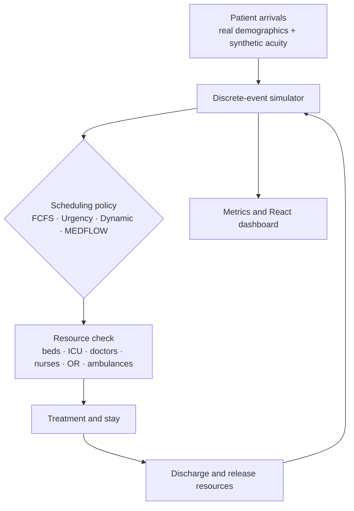

# 🏥 MEDFLOW

### What happens when a hospital runs out of beds, doctors, or ICU space, and who should be treated first?

MEDFLOW is a simulator that replays the same stream of patients through a hospital with limited resources and lets you compare **four different ways of deciding who gets treated next**. An interactive dashboard shows who waits, who gets treated, and where the hospital gets stuck.

---

## 🎯 The idea in 30 seconds

Picture an emergency ward with **20 ICU beds**. All 20 are full, and a critical patient arrives who needs an ICU bed.

- A simple queue **freezes**. The critical patient is first in line, so everyone behind them waits, even if there are plenty of free regular beds and idle doctors.
- **MEDFLOW** notices the blockage, **skips ahead** to the next-most-important patient who *can* be treated right now, and comes back to the critical patient the moment an ICU bed frees up.

The result is less idle capacity and shorter waits, without forgetting the sickest patients.

---

## 📊 What did we find?

Same 300 patients, same hospital, four policies (`seed=42`, Normal Baseline scenario):

| Policy | Avg wait (min) | P95 wait (min) | Throughput (patients/hr) |
| :--- | ---: | ---: | ---: |
| FCFS (first come, first served) | ~1,512 | ~2,899 | 3.23 |
| Urgency only | ~2,159 | ~3,895 | 3.36 |
| Dynamic priority | ~2,240 | ~4,190 | 3.34 |
| **MEDFLOW** | **~965** | ~2,999 | **3.49** |

**In plain words:**
- ✅ MEDFLOW cut the average wait by about **36% vs FCFS** and treated the most patients per hour.
- ⚖️ It is not free. Some unlucky patients wait longer than under FCFS (its max wait and starvation ratio are higher). Balancing this is the interesting open problem.
- 🔬 Absolute waits are huge because this stress test overloads the doctors. Compare the policies against each other rather than reading the raw minutes. Numbers vary slightly between runs.

---

## 🧠 How MEDFLOW decides who goes next

Each waiting patient gets a **priority score** that blends three things:

```
priority = (how urgent)  +  (how long they've waited)  +  (how likely they are to get worse)
```

| Ingredient | Meaning | Default weight |
| :--- | :--- | :---: |
| **Urgency** | Triage level from 1 (low) to 5 (critical) | 0.5 |
| **Waiting time** | Rises with every minute in the queue, so nobody is ignored forever | 0.3 |
| **Deterioration risk** | Based on urgency, age, and whether ICU/OR is needed | 0.2 |

Then MEDFLOW walks down the ranked list and gives resources to **the highest-priority patient whose needs can be met right now**.

<details>
<summary>📐 Show me the math</summary>

$$P_i(t) = w_u U_i + w_a \left(1 - e^{-\lambda W_i}\right) + w_d D_i$$

- $U_i$: urgency (normalized from 1–5), $W_i$: minutes waited, $D_i \in [0,1]$: deterioration risk
- $w_u + w_a + w_d = 1$ (defaults 0.5 / 0.3 / 0.2), $\lambda = 0.01$ by default
- The aging term rises steadily but is capped at 1, so waiting boosts priority without letting it overwhelm clinical urgency:

$$\frac{dA}{dW} = \lambda e^{-\lambda W} > 0 \quad \text{for all } W \ge 0$$

Resource limits are never exceeded. For every resource type $r$ and time $t$:

$$\sum_{i \in \mathcal{A}(t)} x_{i,r}(t) \le C_r$$

</details>

### The four policies you can compare

| # | Policy | One-line description |
| :-: | :--- | :--- |
| 1 | **FCFS** | Strictly by arrival time |
| 2 | **Urgency only** | Sickest first (low-urgency patients can starve) |
| 3 | **Dynamic** | Urgency + waiting time + deterioration risk |
| 4 | **MEDFLOW** | Dynamic priority + skips patients who are blocked by a full resource |

### The hospital being simulated

| 🛏️ Regular beds | 🚨 ICU beds | 🩺 Doctors | 💉 Nurses | 🔪 Operating rooms | 🚑 Ambulances |
| :-: | :-: | :-: | :-: | :-: | :-: |
| 120 | 20 | 35 | 80 | 6 | 6 |

A single patient may need several of these **at the same time** (a bed plus a doctor plus nurses, and sometimes an ICU bed or OR). That is what makes the scheduling hard.

---

## 🖥️ The dashboard

A React app with three pages and five interactive charts, all drawn in plain SVG.

| Page | What you can do |
| :--- | :--- |
| **Operations Overview** | See live resource-usage cards, compare policies in a bar chart, and see how well the ML model predicts stay length |
| **Patient Queue & Detail** | Browse the live priority queue (top 10), search and filter patients, click one to see *why* they got their score, and watch queue length over time |
| **Simulation Lab** | Pick a scenario (**Normal Baseline, Emergency Surge, Staff Shortage, ICU Constraint, Resource Failure**), drag sliders to change capacities, and compare all four policies on Avg Wait, P95 Wait, Throughput, and LWBS % (left without being seen) |

---

## 🚀 Try it in 2 minutes

You need **Python 3.10+** and **Node.js 18+**.

```bash
# 1. Get the code
git clone https://github.com/neevkasliwal/Medflow.git
cd Medflow

# 2. Python environment
python -m venv venv
source venv/bin/activate          # Windows: venv\Scripts\activate
pip install -r requirements.txt

# 3. Start the backend  →  http://127.0.0.1:8000  (API docs at /docs)
python -m uvicorn backend.api.main:app --reload --port 8000
```

In a **second terminal**:

```bash
# 4. Start the dashboard  →  http://localhost:5173
cd Medflow/frontend
npm install
npm run dev
```

Open <http://localhost:5173> and click **Simulation Lab** to start experimenting. The dashboard talks to the backend through a built-in proxy, so start the backend first.

**Run the tests**

```bash
python -m unittest discover tests     # or: python -m pytest tests -q
```

<details>
<summary>🛠️ Troubleshooting</summary>

- **Tests fail with `NameError: name 'Tuple' is not defined`**: in `backend/scheduling/allocator.py`, change line 1 to `from typing import Dict, List, Optional, Tuple`. With that fix all 27 tests pass.
- **TestClient complains about a missing HTTP client**: install the package named in the error (typically `httpx`).
- **Run commands from the repo root.** The backend looks for `data/real/...` relative to it.

</details>

---

## 🔌 API at a glance

Start the backend and open **<http://127.0.0.1:8000/docs>** for interactive docs.

| Endpoint | Method | What it does |
| :--- | :-: | :--- |
| `/api/status` | GET | Health check, dataset stats, hospital capacities |
| `/api/ml-metrics` | GET | ML accuracy and feature importances |
| `/api/simulate` | POST | Run one simulation (scenario, policy, patient count, custom capacities) |
| `/api/custom-simulate` | POST | Alias of `/api/simulate` |
| `/api/same-seed-compare` | POST | Run all 4 policies on the *identical* patient stream |
| `/api/priority-breakdown/{id}` | GET | Explain one patient's priority score |
| `/api/experiments` | POST | Full grid: 5 scenarios × 4 policies |

Quick example:

```bash
curl -X POST http://127.0.0.1:8000/api/same-seed-compare \
  -H "Content-Type: application/json" \
  -d '{"n_patients": 300, "seed": 42}'
```

---

## 🔍 Under the hood



- **Simulator:** a Python `heapq` event loop with five events: `ARRIVAL`, `ALLOCATE`, `TREATMENT_COMPLETE`, `RESOURCE_RELEASE`, `DISCHARGE`.
- **ML model:** a Random Forest predicts how long each patient will stay, and the scheduler uses that prediction.
  - Features: age, urgency, admission track, ICU/OR flags, department.
  - Typical accuracy: **MAE ≈ 115 min, R² ≈ 0.62**. The training target is synthetic, so this measures how well the model learns the simulator's rules, not real-world accuracy.
- **Metrics tracked:** average / P95 / max wait, throughput, resource utilization, wait by urgency tier, and a starvation ratio (P95 ÷ mean wait).

<details>
<summary>📦 Data: what's real and what's synthetic?</summary>

Public datasets don't include inpatient details, so MEDFLOW mixes real and generated data:

| Field | Source |
| :--- | :--- |
| Arrival time, age, gender, department | **Real** dataset |
| Urgency (1–5), ICU/OR needs, doctors and nurses needed, true stay length | **Synthetic**, from explicit rules |
| Predicted stay length | **ML model** |

Two CSVs live in `data/real/`:
- `healthcare_analytics_patient_flow_data.csv`: 9,216 patients, Jan 2023 to Dec 2024.
- `working_with_age_gender.csv`: a 396-row working sample that **the API currently loads first**. To use the full dataset, change `DATA_PATH` in `backend/api/main.py`.

Cleaning done on load: mixed date formats parsed (`YYYY-MM-DD`, `MM/DD/YYYY`, `DD-MM-YYYY`), 17 corrupted `Femaleemale` gender values repaired, and the ~59% missing department values kept as a real category (`No specialist referral`).

</details>

<details>
<summary>🗂️ Project structure</summary>

```text
Medflow/
├── backend/
│   ├── api/          # FastAPI endpoints
│   ├── models/       # Patient class and synthetic generator
│   ├── scheduling/   # Priority formula and MEDFLOW allocator
│   ├── simulation/   # Discrete-event engine and experiment runner
│   ├── ml/           # Stay-duration predictor
│   └── utils/        # Data loading and cleaning
├── frontend/         # React + TypeScript + Vite dashboard
├── data/real/        # Datasets and mock-data script
├── docs/             # Full technical specification
├── tests/            # 27 tests (data, generator, scheduling, simulation, ML, API)
└── requirements.txt
```

For the deep dive, see [`docs/MEDFLOW_SYSTEM_SPECIFICATION.md`](docs/MEDFLOW_SYSTEM_SPECIFICATION.md).

</details>

---

## 🙌 Credits

Built for a 24-hour hackathon on Hospital Operational Analytics & Optimization.
